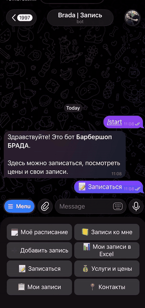
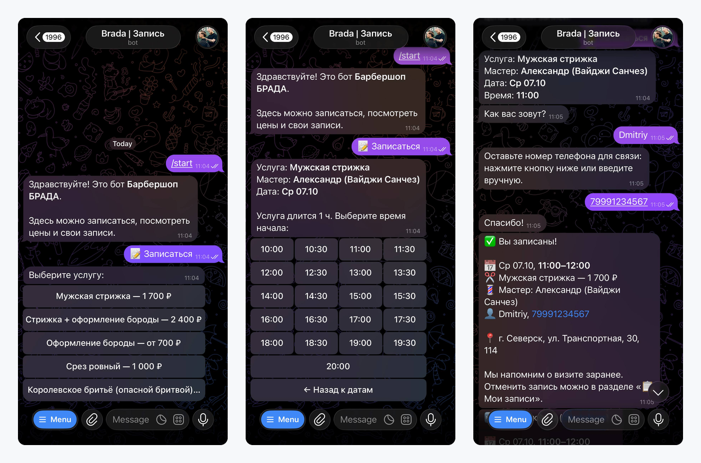
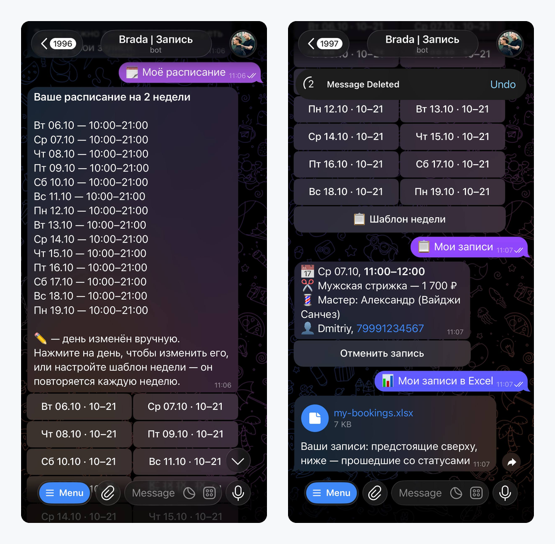

# Telegram-запись для салонов и барбершопов

Онлайн-запись прямо в Telegram: клиент записывается в пару нажатий, мастер ведёт расписание в боте, владелец видит всё по салону. Без приложений, сайтов и личных кабинетов — всё в мессенджере, которым клиенты и мастера и так пользуются каждый день.

<!-- Скриншоты: docs/client.png, docs/master.png, docs/owner.png, docs/demo.gif -->

## Для клиента

- **Запись за минуту:** услуга → мастер → дата → свободное время → имя и телефон
- **Только реально свободное время:** бот учитывает длительность услуги, расписание мастера и уже занятые часы
- **Напоминания о визите** за сутки и за 2 часа — с кнопками «✅ Приду» и «Отменить запись»
- **«Мои записи»:** посмотреть и отменить запись в любой момент
- Прайс, адрес и контакты салона — в одном месте

## Для мастера

- **Расписание прямо в Telegram:** шаблон недели + изменения отдельных дней, всё кнопками
- **Уведомление о каждой новой записи** и отмене
- **Ручная запись** клиентов, которые позвонили по телефону: день → услуга → время → имя
- **Журнал записей:** отмена, отметка «клиент не пришёл»
- **Утренняя сводка** на день и напоминание в воскресенье проверить расписание
- **Выгрузка своих записей в Excel** — предстоящие и прошедшие со статусами

## Для владельца

- **Все записи салона:** на сегодня и на завтра по каждому мастеру
- **Подключение мастеров** одноразовой ссылкой — без настроек и паролей
- **Владелец может быть и мастером** — одно меню, без двойных уведомлений
- **Уведомления на выбор:** все записи сразу, сводка раз в день или только свои
- **Выгрузка в Excel:** сводка по мастерам (записи, неявки, отмены, выручка) и лист на каждого мастера
- Видно, сколько клиентов записались через бота, а сколько — по телефону

## Как устроено

- Записи подтверждаются автоматически, если время свободно по расписанию мастера — клиенту не нужно ждать ответа
- Нельзя закрыть в расписании время, на которое уже записан клиент: бот покажет мешающие записи
- Время считается в часовом поясе салона
- Данные салона хранятся отдельно от других салонов; бот работает круглосуточно на сервере

## Подключение салона

1. Создаём бота с названием и логотипом салона.
2. Вносим услуги, цены, длительность и мастеров.
3. Владелец и мастера подключаются по ссылкам и настраивают расписание.
4. Ссылку на бота можно разместить в Instagram, ВКонтакте, на картах 2ГИС и Яндекс, на визитках и в QR-коде на ресепшене.

Запуск — за один день.

## Стек

TypeScript · Node.js · grammY (Telegram Bot API) · ExcelJS

---

**Хотите такого бота для своего салона?** Напишите в Telegram: [@kotokuro(https://t.me/kotokuro)
